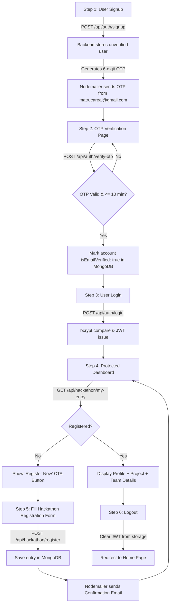

# MatruCare AI — Hackathon Registration Portal

> **Role:** Full Stack Developer Intern  
> **Stack:** MERN (MongoDB, Express.js, React.js, Node.js) + Nodemailer  
> **Official Email:** `matrucareai@gmail.com`  
> **Level:** Intermediate  

---

## 📌 Project Overview

**MatruCare AI Hackathon Portal** is a production-ready, full-stack web application designed and developed using the **MERN Stack** (MongoDB, Express.js, React.js, Node.js) with complete CRUD operations and automated email notifications via **Nodemailer**.

The platform provides an end-to-end hackathon workflow allowing participants to:
1. **Register** for an account with custom validation.
2. **Verify identity via a 6-digit OTP** sent to their email with a 10-minute expiry.
3. **Log in securely** using bcrypt-hashed credentials and receive a JWT session token.
4. **Access a private Participant Dashboard** displaying personal profile details and registration status.
5. **Submit a comprehensive Hackathon Registration form** featuring dynamic team member inputs (1–5 members), academic information, project domain, and resource links.
6. **Receive automated confirmation emails** from `matrucareai@gmail.com` containing full participant, project, and team details.

---

## 🚀 Technology Stack

| Layer | Technology | Purpose |
|---|---|---|
| **Frontend** | React.js (Vite) + Tailwind CSS | Fast, accessible, responsive UI with mobile drawer & components |
| **Icons & Routing** | Lucide React + React Router v7 | Modern icons, active link highlighting & protected routes |
| **Backend** | Node.js + Express.js (ES Modules) | High-performance RESTful API & business logic |
| **Database** | MongoDB + Mongoose | Schemas, validations, unique indexes & persistent storage |
| **Authentication** | JWT (jsonwebtoken) + bcryptjs | Secure password hashing & stateless JWT guard |
| **Email Service** | Nodemailer (`matrucareai@gmail.com`) | SMTP transport for OTP verification & registration receipts |
| **OTP Generation** | Custom Cryptographic Generator | 6-digit random code, 10-min TTL, single-use invalidation |

---

## 📋 Required Components & Pages

| # | Component / Page | Route | Description |
|---|---|---|---|
| 1 | **Home** | `/` | Hero section with CTAs (*Register Now* / *Login*), event highlights, timeline milestones, prizes & rewards breakdown. |
| 2 | **Navbar** | *All pages* | Responsive navigation: Logo (*MatruCare AI*), links to Home, About, Contact, Login, Signup. Mobile hamburger drawer. |
| 3 | **Footer** | *All pages* | Company footer with copyright, social links (GitHub, LinkedIn, Twitter, Web), contact email (`matrucareai@gmail.com`), and quick-nav. |
| 4 | **Signup** | `/signup` | Full Name, Email, Password, Confirm Password. On submit → hashes password, sends 6-digit OTP via Nodemailer → redirects to `/verify-otp`. |
| 5 | **OTP Verify** | `/verify-otp` | 6-digit interactive OTP input, 10-minute countdown expiry, resend cooldown timer. On verify → marks user verified in DB → redirects to `/login`. |
| 6 | **Login** | `/login` | Email + Password login. Authenticates with bcrypt, generates JWT, saves session to localStorage → redirects to `/dashboard`. |
| 7 | **Dashboard** | `/dashboard` | **Protected route (JWT guard)**. Displays user profile and hackathon submission. If not registered → prominent *Register Now* CTA linking to registration. |
| 8 | **Registration** | `/registration` & `/hackathon-registration` | **Protected route**. 14-field form with dynamic team boxes (1–5 members). On submit → saves to MongoDB + sends confirmation email via Nodemailer. |
| 9 | **Contact** | `/contact` | Contact form (Name, Email, Subject, Message) with company email (`matrucareai@gmail.com`) displayed. |
| 10 | **About** | `/about` | Mission, tracks, hackathon guidelines, and objectives. |

---

## 📝 Hackathon Registration Form Fields

| # | Field Label | Input Type | Notes & Validation |
|---|---|---|---|
| 1 | **Full Name** | Text Input | Min 3 chars, letters and spaces only |
| 2 | **Email Address** | Email Input | Valid email, pre-filled from auth session (read-only) |
| 3 | **Mobile Number** | Tel Input | 10-digit Indian mobile number (`^[6-9]\d{9}$`) |
| 4 | **College Name** | Dropdown / Select | Pre-defined list of universities & colleges |
| 5 | **Course** | Dropdown / Select | B.Tech, M.Tech, BCA, MCA, BSc, Other |
| 6 | **Branch** | Dropdown / Select | CSE, IT, ECE, ME, CE, Other |
| 7 | **Year of Study** | Dropdown / Select | 1st, 2nd, 3rd, 4th year |
| 8 | **Domain / Track** | Dropdown / Select | AI/ML, Web Dev, IoT, Cyber Security, Blockchain, Other |
| 9 | **Project Name** | Text Input | Min 5 characters, max 100 characters |
| 10 | **PPT Link** | URL Input | Google Drive / OneDrive shareable presentation link |
| 11 | **Prototype Link** | URL Input | GitHub / Figma / Live demo link |
| 12 | **Demo Video Link** | URL Input | YouTube / Drive link (*Optional*) |
| 13 | **Team Size** | Number Select | 1 to 5 members |
| 14 | **Team Members** | Dynamic Fields | When Team Size = 1: Solo (no extra member boxes). When Team Size = 2–5: Dynamically renders entry boxes asking for Member Name + Member Email. |

---

## 🔄 User Flow & Authentication Logic



---

## 📡 CRUD Operations — API Endpoints

| Operation | HTTP Method | Endpoint | Protection | Description |
|---|---|---|---|---|
| **CREATE** | `POST` | `/api/auth/signup` | Public | Register new user account & dispatch 6-digit OTP |
| **CREATE** | `POST` | `/api/auth/verify-otp` | Public | Verify 6-digit OTP and activate user account |
| **CREATE** | `POST` | `/api/auth/resend-otp` | Public | Resend fresh OTP with cooldown throttling |
| **READ** | `POST` | `/api/auth/login` | Public | Authenticate user credentials & return JWT |
| **READ** | `GET` | `/api/user/me` | JWT Guard | Fetch logged-in user profile |
| **UPDATE** | `PUT` | `/api/user/update` | JWT Guard | Update user profile details *(optional endpoint)* |
| **CREATE** | `POST` | `/api/hackathon/register` | JWT Guard | Submit hackathon registration & trigger confirmation email |
| **READ** | `GET` | `/api/hackathon/my-entry` | JWT Guard | Fetch logged-in user's hackathon registration entry |
| **DELETE** | `DELETE` | `/api/hackathon/:id` | JWT Guard | Delete hackathon registration entry *(admin / optional)* |
| **CREATE** | `POST` | `/api/contact` | Public | Send contact inquiry message |
| **READ** | `GET` | `/api/test` | Public | Health check endpoint |

---

## ✉️ Nodemailer Email Configuration

Emails are dispatched through Nodemailer using official SMTP credentials:
- **Sender Name:** `MatruCare AI`
- **From Address:** `matrucareai@gmail.com`
- **Guidelines:** As per brief rules, no personal candidate name is included in email templates. The sender identity is always strictly `MatruCare AI <matrucareai@gmail.com>`.

### Email Types:
1. **User Signup (OTP):**
   - 6-digit security code.
   - Time-limited (10-minute expiry).
   - Invalidation after first use.
2. **Hackathon Registration Confirmation:**
   - Participant Name, Email, Mobile.
   - College, Course, Branch, Year of Study.
   - Domain / Track, Project Name, PPT URL, Prototype URL, Video URL.
   - Complete Team Details (Lead + Team Members table).
   - Timestamp and registration record.

---

## ⚙️ Environment Variables Guide

### Server (`server/.env`)
Create a `.env` file in `/server` based on `.env.example`:

```env
PORT=5000
MONGO_URI=mongodb+srv://<username>:<password>@cluster.mongodb.net/matrucare
JWT_SECRET=your_jwt_secret_key_here

# Nodemailer SMTP Configuration
EMAIL_PASS=your_gmail_app_password
EMAIL_FROM=matrucareai@gmail.com
SMTP_HOST=smtp.gmail.com
SMTP_PORT=587
SMTP_USER=matrucareai@gmail.com
SMTP_PASS=your_gmail_app_password

# Client CORS
CLIENT_URL=http://localhost:5173
```

### Client (`client/.env`)
Create a `.env` file in `/client` based on `.env.example`:

```env
VITE_API_BASE_URL=http://localhost:5000
```

---

## 💻 Local Setup & Installation

### Prerequisites
- Node.js (v18 or higher)
- MongoDB (Local or MongoDB Atlas cluster)
- Gmail App Password for SMTP authentication

### 1. Clone the repository
```bash
git clone https://github.com/your-username/matrucare-portal.git
cd MatruCare
```

### 2. Backend Setup
```bash
cd server
npm install
# Configure your .env file
npm run dev
# Server will start on http://localhost:5000
```

### 3. Frontend Setup
```bash
cd ../client
npm install
# Configure your .env file
npm run dev
# Vite will start on http://localhost:5173
```

---

## 📂 Project Directory Structure

```text
MatruCare/
├── client/
│   ├── public/
│   │   ├── favicon.svg
│   │   └── icons.svg
│   ├── src/
│   │   ├── assets/
│   │   ├── components/
│   │   │   ├── AuthLayout.jsx
│   │   │   ├── Footer.jsx
│   │   │   ├── Navbar.jsx
│   │   │   └── ProtectedRoute.jsx
│   │   ├── context/
│   │   │   └── AuthContext.jsx
│   │   ├── pages/
│   │   │   ├── About.jsx
│   │   │   ├── Contact.jsx
│   │   │   ├── Dashboard.jsx
│   │   │   ├── HackathonRegistration.jsx
│   │   │   ├── Home.jsx
│   │   │   ├── Login.jsx
│   │   │   ├── Signup.jsx
│   │   │   └── VerifyOtp.jsx
│   │   ├── services/
│   │   │   └── api.js
│   │   ├── App.jsx
│   │   ├── main.jsx
│   │   └── index.css
│   ├── .env.example
│   ├── index.html
│   ├── package.json
│   └── vite.config.js
│
├── server/
│   ├── config/
│   │   └── db.js
│   ├── controllers/
│   │   ├── authController.js
│   │   ├── contactController.js
│   │   ├── hackathonController.js
│   │   └── userController.js
│   ├── middleware/
│   │   ├── authMiddleware.js
│   │   └── errorMiddleware.js
│   ├── models/
│   │   ├── HackathonRegistration.js
│   │   └── User.js
│   ├── routes/
│   │   ├── authRoutes.js
│   │   ├── contactRoutes.js
│   │   ├── hackathonRoutes.js
│   │   ├── testRoutes.js
│   │   └── userRoutes.js
│   ├── services/
│   │   └── emailService.js
│   ├── utils/
│   │   └── generateOtp.js
│   ├── .env.example
│   ├── package.json
│   └── server.js
│
├── .gitignore
└── README.md
```

---

## 🔒 Security & Rules Compliance Checklist

- [x] **No candidate name in emails:** Templates strictly use `MatruCare AI` as sender.
- [x] **Official Sender Address:** All automated communications originate from `matrucareai@gmail.com`.
- [x] **Protected Routes:** All routes except Home, Login, Signup are guarded by JWT middleware and React route guards.
- [x] **Password Security:** Passwords hashed with `bcryptjs` (salt rounds: 12) before persisting in MongoDB.
- [x] **Time-limited OTPs:** 6-digit OTPs expire in 10 minutes and are wiped immediately upon verification.
- [x] **Environment Security:** No secrets or credentials hardcoded. Full `.env.example` provided.
- [x] **Responsive Layout:** Tested across mobile, tablet, and desktop screens with mobile drawer navigation.

---

## 📄 License & Attribution

Developed for the **MatruCare AI Full Stack Developer Track Internship Programme**.  
Company Contact: [matrucareai@gmail.com](mailto:matrucareai@gmail.com)
